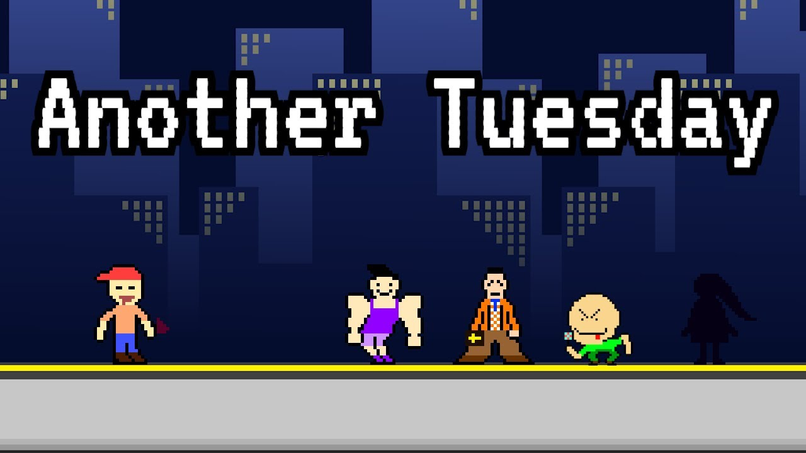

[AnotherTuesday](https://github.com/kallui/AnotherTuesday) was built in a weekend at Global Game Jam Vancouver 2024 by Team Big Dogs, a team of six developers, artists, writers, and audio designers.

## Trailer

## Development

I was the main developer on the team and owned all of the Unreal Engine code. The game is built in Unreal Engine 5 using Blueprints and Paper2D for sprite-based characters and tilemaps.

- Player Character: Movement, jumping, and attacks wired up through Enhanced Input, with sprite animations for idle, walking, attacking, and getting hurt.
- Enemy AI: Behavior Trees and Blackboards for enemies that follow and attack the player, plus follow-only variants.
- Level & UI: Tilemap-based levels, an HP bar, a main menu, and a pause menu.

## Controls

| Key | Action |
| --- | --- |
| A / D | Move left and right |
| Space | Jump |
| Left Click | Attack |

@[Another Tuesday](https://globalgamejam.org/games/2024/another-tuesday-9 "Global Game Jam 2024 game page")

@[kallui/AnotherTuesday](https://github.com/kallui/AnotherTuesday "Source code and download instructions")
