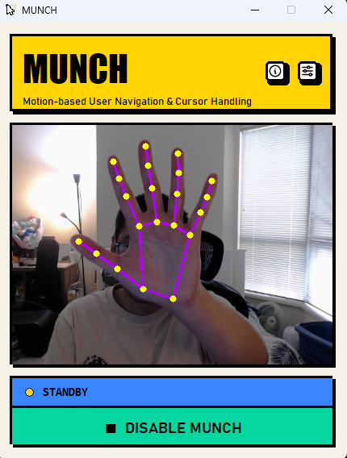
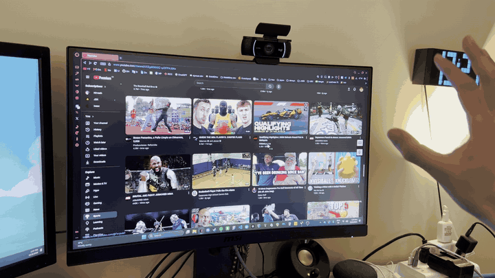
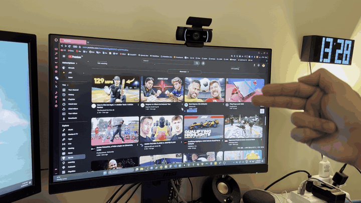
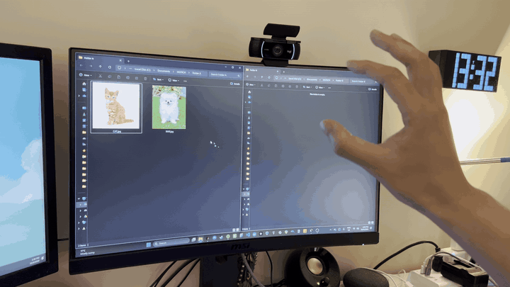
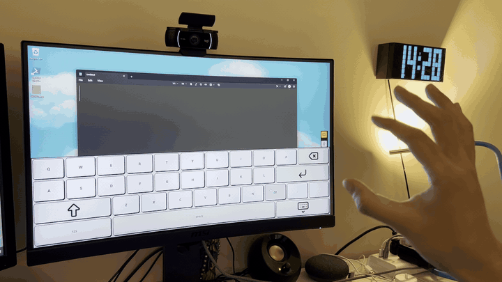
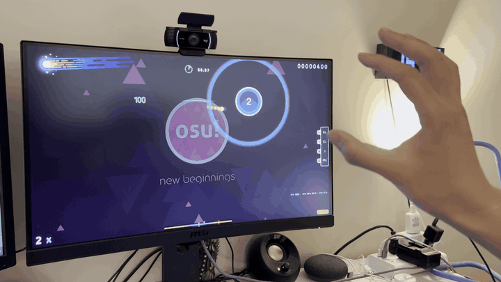
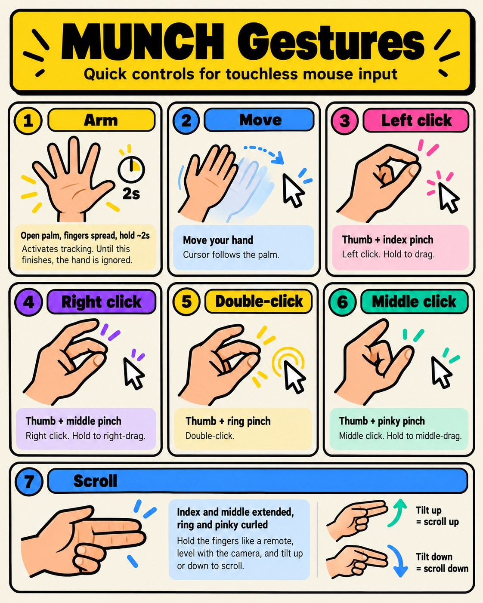

[Download MUNCH →](https://github.com/kallui/munch/releases/latest)



## Overview

MUNCH (Motion-based User Navigation & Cursor Handling) lets you control your Windows PC with hand gestures while you're eating, your hands are dirty, or you just don't want to touch your mouse and keyboard.

All it needs is a webcam, and both hand tracking and speech recognition run entirely on your machine.

## The Wake-Up System

The biggest problem with gesture control is unwanted input. Your hands are constantly in view: reaching for food, picking up a drink, scratching your face. If every hand movement moved the cursor, you'd be clicking on things by accident all the time.

MUNCH solves this with a wake-up gesture. It ignores your hand completely until you deliberately wake it up, and goes back to sleep as soon as you're done.

### 1. Standby

MUNCH sees your hand but does nothing with it. No cursor movement, no clicks.

### 2. Wake up

Hold up an open palm with your fingers spread for about two seconds. A dial fills up while you hold it, and if you break the pose it drains back down, so a hand passing through the frame won't wake MUNCH by accident.

### 3. Active

Now the cursor follows your palm, and pinches, drags, and scrolls all work.

### 4. Back to sleep

Drop your hand out of the frame and MUNCH immediately returns to standby, releasing any held buttons. Go back to eating without worrying about stray clicks.

## Showcase











## Features

- Hands-off mouse: Palm position drives the cursor. Pinches click, holding a pinch drags, and a finger gun scrolls.
- Won't click while you eat: MUNCH ignores your hand until you deliberately arm it with an open palm, and disarms as soon as your hand leaves the frame.
- On-screen keyboard: A large bottom-docked keyboard you can pinch-type into whatever app is focused.
- Dictation: Tap the mic and talk. A live caption shows the words as they are heard, and the transcript is typed into the focused window. Speech recognition runs locally.
- Custom bindings: Any pinch can be rebound to any click in Settings.
- Calibration: Set the motion boundary so a comfortable sweep of your hand covers the whole screen, whatever the camera angle.

## Gestures



| Gesture | Default action |
| --- | --- |
| Open palm, fingers spread, hold ~2s | Arm MUNCH |
| Move your hand | Cursor follows the palm |
| Thumb + index pinch | Left click, hold to drag |
| Thumb + middle pinch | Right click, hold to right-drag |
| Thumb + ring pinch | Double-click |
| Thumb + pinky pinch | Middle click, hold to middle-drag |
| Finger gun | Scroll, tilt up or down |
| Hand leaves the frame | Disarm |

## How It Works

Each camera frame goes through four steps:

```
Webcam frame
    │
 Capture   OpenCV reads and mirrors the frame
    │
 Track     MediaPipe Hand Landmarker returns 21 hand points
    │
 Recognize State machine: wake pose → pinch → scroll → movement
    │
 Act       pynput moves the cursor, clicks, and types
```

Gestures are debounced so a hand entering the frame doesn't fire a stray click. The on-screen keyboard and dictation overlays are built as always-on-top windows that don't steal focus, so input always lands in the app you're using.

## Packaging & Distribution

MUNCH is packaged with PyInstaller and Inno Setup into a standard Windows installer that does not require admin rights and upgrades in place while keeping user settings. Releases are published on GitHub.

@[kallui/munch](https://github.com/kallui/munch "Motion-based User Navigation & Cursor Handling")
