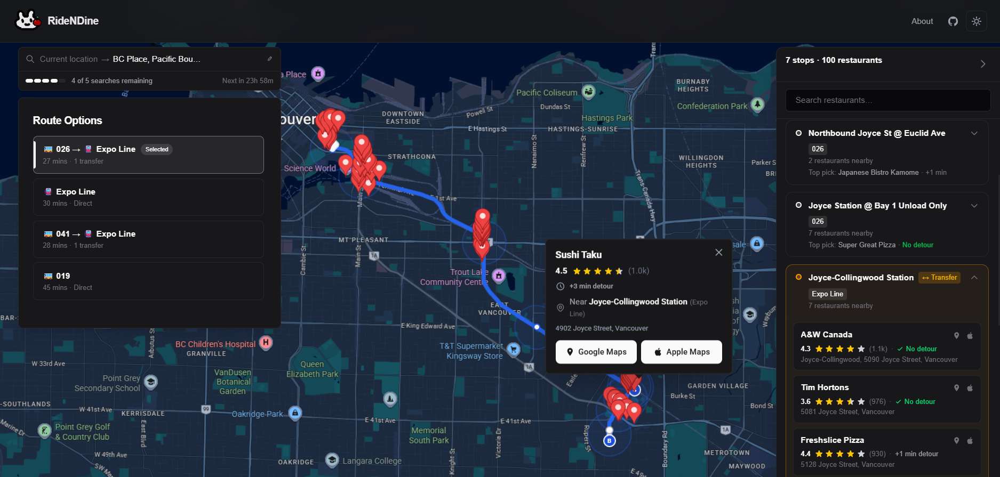
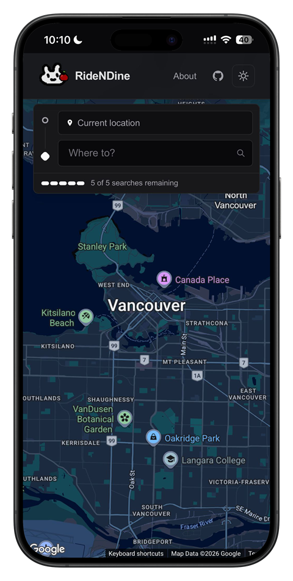
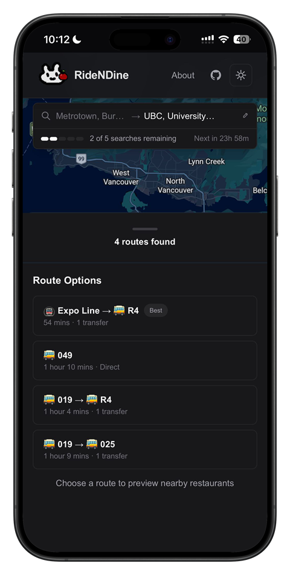
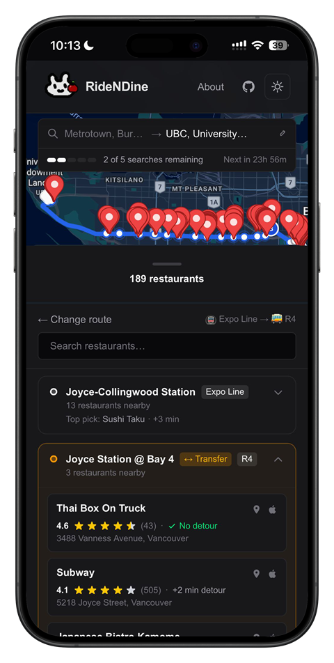
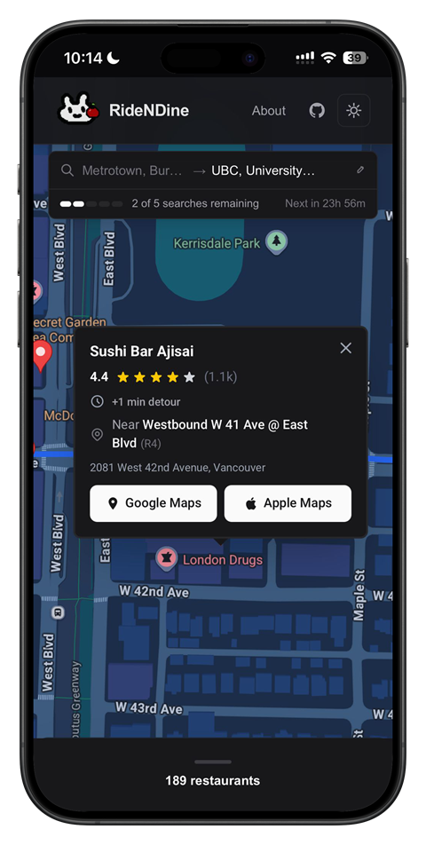

[Try RideNDine →](https://ridendine.app)

## Overview

RideNDine started from my own commute. Spending hours on transit each day, I often wanted dinner on the way home, but finding food that fit my route meant checking stops and restaurants one by one.

Google Maps and Apple Maps make this easy for drivers. For transit riders, it doesn't. I built RideNDine to close that gap.

The application takes a user's origin and destination, determines their public transit route, and finds restaurants along the journey that are within walking distance of transit stops or points along the route.

## How It Works

### 1. Enter your route

Enter your starting point and destination to plan your trip.

### 2. Pick your route

Choose the transit option that works best for you.

### 3. Explore food options along the way

RideNDine finds restaurants within a ~5-minute walk of your transit path. Search by restaurant name, and tap the restaurant cards or markers on the map for details.

### 4. Open in your maps app

Found somewhere you like? Open it directly in your preferred maps app for walking directions and navigation.

## Screenshots

RideNDine is available on both web and mobile. On mobile, it is set up as a PWA, so you can add it to your home screen and use it like a native app.

---








## Migrating from Vercel to AWS

As RideNDine grew to support more cities, the original serverless architecture became increasingly restrictive.

The application processes large transit datasets, and some of that processing required more memory and execution time than was practical within the serverless environment. I decided to move the application to a dedicated AWS environment to have more control over compute resources and how data processing was handled.

The migration moved RideNDine from Vercel to an AWS Lightsail production server running Ubuntu, with Nginx handling the web server and reverse proxy layer.

### Infrastructure

| Component | Role |
| --- | --- |
| AWS Lightsail | Application server |
| Ubuntu Linux | OS |
| Nginx | Reverse proxy and web server |
| S3 | Storage for GTFS data |
| Docker | Redis container |
| Terraform | IaC |
| GitHub Actions | CI/CD and scheduled data processing |
| IAM + OIDC | GitHub Actions and Lightsail authentication |

### Moving Heavy Processing Out of Production Server

One of the main challenges was the server's 2 GB RAM limit.

The weekly transit data processing job was memory-intensive enough that running it directly on the production server could cause out-of-memory failures. Instead of upgrading the server, I moved the heavy processing into GitHub Actions.

The workflow now looks like:

```
GitHub Actions → Process data → S3 → Production server
```

GitHub Actions processes the data and uploads the completed artifacts to a private S3 bucket. The production server only needs to download and serve the processed data.

This keeps resource-intensive workloads out of the production environment and allows the application to continue running on a relatively small instance.

### AWS Security & CI/CD

I also redesigned the deployment workflow around GitHub Actions OIDC and least-privilege IAM.

GitHub Actions can publish processed artifacts to S3, while the production server only has permission to read from the bucket.

This means the CI pipeline does not require long-lived AWS credentials, and the production server cannot modify or delete the stored artifacts.

### Deployment Flow

```
GitHub Actions
      │
      │ OIDC authentication
      ▼
   AWS IAM
      │
      │ write
      ▼
 Private S3
      │
      │ read
      ▼
AWS Lightsail
      │
      ▼
   RideNDine
```

### Optimizing Performance Within 2 GB RAM

Moving the processing workload off the server solved the biggest memory problem, but the application still needed to efficiently serve transit data from a relatively small 2 GB instance.

To evaluate worst-case performance, I created a benchmark simulating simultaneous requests for different cities' transit data. The initial benchmark showed that a request requiring a city whose data was not already loaded could take ~17 seconds under this worst-case scenario.

I optimized the data-loading architecture by pre-caching processed GTFS data on disk and using LRU caching and concurrency limits, reducing the worst-case data-loading latency to ~45ms while staying within the server's memory constraints.

### Result

~17s → ~45ms

Data-loading latency under simulated worst-case load

## Expanding to More Cities

RideNDine originally focused on Metro Vancouver, using TransLink's GTFS data to find real bus stops, SkyTrain stations, SeaBus terminals, and other transit services along a user's route.

The underlying transit-data architecture has since been expanded to support additional cities.

### Current Transit Coverage

| City | Country | Transit data |
| --- | --- | --- |
| Metro Vancouver | Canada | TransLink |
| Toronto | Canada | TTC + GO Transit |
| Montréal | Canada | STM + REM |
| Seattle / Puget Sound | United States | Sound Transit + King County Metro |
| Portland | United States | TriMet |
| Chicago | United States | CTA + Pace |
| Greater Boston | United States | MBTA |
| Denver | United States | RTD |
| Austin | United States | CapMetro |

RideNDine currently supports transit data from 9 metropolitan areas, with additional transit systems planned.

## Usage Limits

RideNDine currently allows up to 5 route searches within any rolling 24-hour period to help keep the project sustainable.

Caching, rate limiting, and server-side data processing help reduce unnecessary API usage and infrastructure costs.

## Technical Architecture

### Frontend

- React
- TypeScript
- Next.js
- Tailwind CSS

### Backend & Data

- Next.js server-side functionality
- Google Maps / Places APIs
- GTFS transit data
- Redis

### Infrastructure

- AWS Lightsail
- Amazon S3
- Docker
- Nginx
- Terraform
- GitHub Actions
- AWS IAM / OIDC
- Ubuntu Linux
