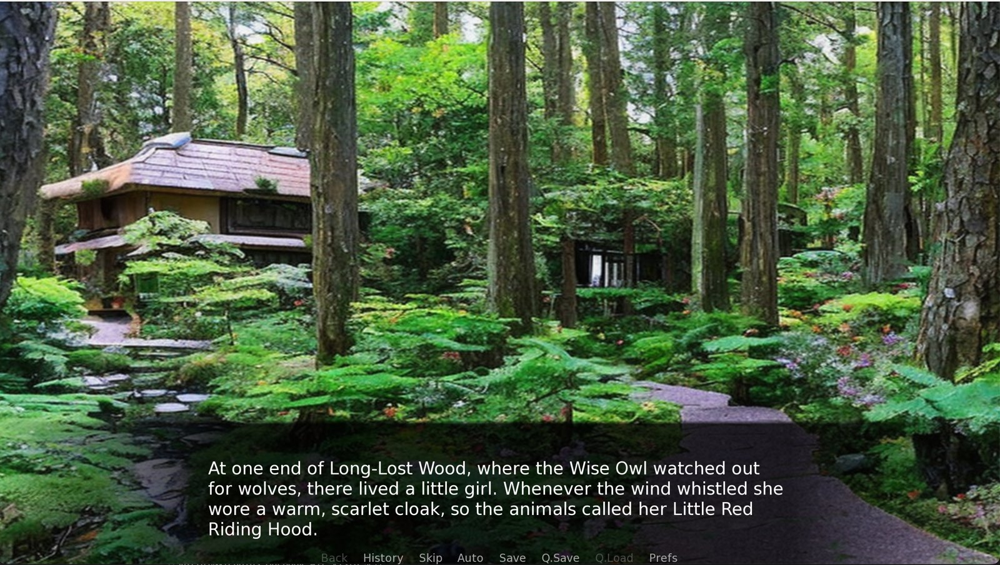
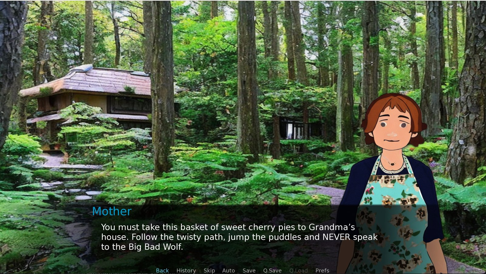
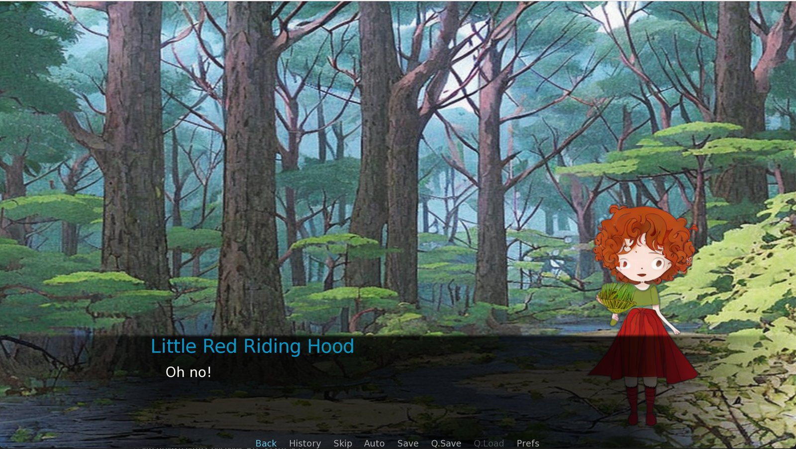

[Visto](https://github.com/kallui/Visto) takes a story as a PDF or raw text and turns it into a playable visual novel game, complete with character art, scene backgrounds, and music.

## Features

- Story Conversion: GPT-3 extracts the key story elements, including characters, physical descriptions, dialogue, and the mood of each scene.
- Custom Artwork: Stable Diffusion generates artwork for each character and scene background in a style reminiscent of Studio Ghibli.
- Mood-Based Music: Each scene gets background music that matches its mood, such as upbeat music for happy scenes or tense music for suspenseful ones.
- Interactive Visual Novel: The extracted story data is compiled into a visual novel game using the Ren'Py Python engine.

## Preview: Little Red Riding Hood

Input: the text of [Little Red Riding Hood](https://americanliterature.com/childrens-stories/little-red-riding-hood). Output:

@[kallui/Visto](https://github.com/kallui/Visto "nwHacks 2023 project: converts written stories into engaging visual experiences")
