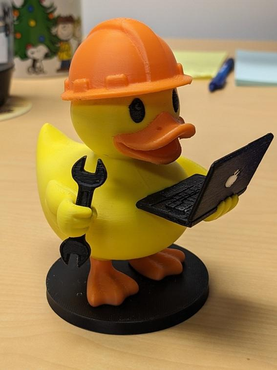

## Software Developer Co-op

I worked as part of the Common Engineering team, which focuses on improving developer experience across [WorkSafeBC](https://www.worksafebc.com) by establishing standardized engineering practices, tools, and workflows.

### GitHub Copilot Instructions

One of the main projects was improving the adoption of GitHub Copilot within the organization. Since AI-generated code did not consistently follow internal coding standards, I explored different approaches and implemented custom GitHub Copilot instruction files for Angular development. I integrated these instructions into the standardized Angular application blueprint, so developers creating a new Angular project would have these instruction files ready to use. I presented a demo to stakeholders while answering questions and gathering feedback.

Here's a link to the blog post I wrote about the project:

@[Coding Standards Made Simple: Harness GitHub Copilot](https://wsbctechnicalblog.github.io/coop-github-copilot-instructions.html "The Challenges with Copilot Out of the Box")

### Dependency Tracking

I also led an initiative to improve dependency tracking across WorkSafeBC’s growing number of applications and services. I interviewed stakeholders to understand the current approach and challenges, evaluated different approaches, and presented findings through monthly project updates. At the end of the project, I delivered a final recommendation along with the implementation roadmap, estimated costs, and risk mitigation strategies.

### CI/CD & Blueprints

Outside of larger projects, I contributed to the team’s day-to-day engineering work by taking tickets related to CI/CD pipeline improvements. This involved troubleshooting missing configurations and supporting the release of updated Angular and .NET application blueprints.

### A Parting Gift

Before I left the Common Engineering team, I wanted to leave them with a physical reminder of my favorite debugging tip: if you're ever stuck, talk it out like you would with a rubber duck. I created a rubber duck model but DevOps themed and 3D-printed it, and gave it to the team.

---

## Quality Assurance Co-op

I worked on the Claim Management System (CMS), one of WorkSafeBC’s largest applications used by employees to manage injured workers’ claims. As part of the QA team, I worked with developers to ensure new features met both technical requirements and business needs before release.

### Testing & Defect Tracking

My main responsibilities were validating new features and identifying issues early. I worked closely with user stories and business requirements to design test cases that covered a wide range of user scenarios, including different claim types, injury details, workflow conditions, and other factors. I documented defects and collaborated with developers to fix issues.

### Stakeholder Demo

I also had the opportunity to present a live demo of our team’s new solution to over 100 internal stakeholders, explaining the changes and improvements compared to the previous implementation.
